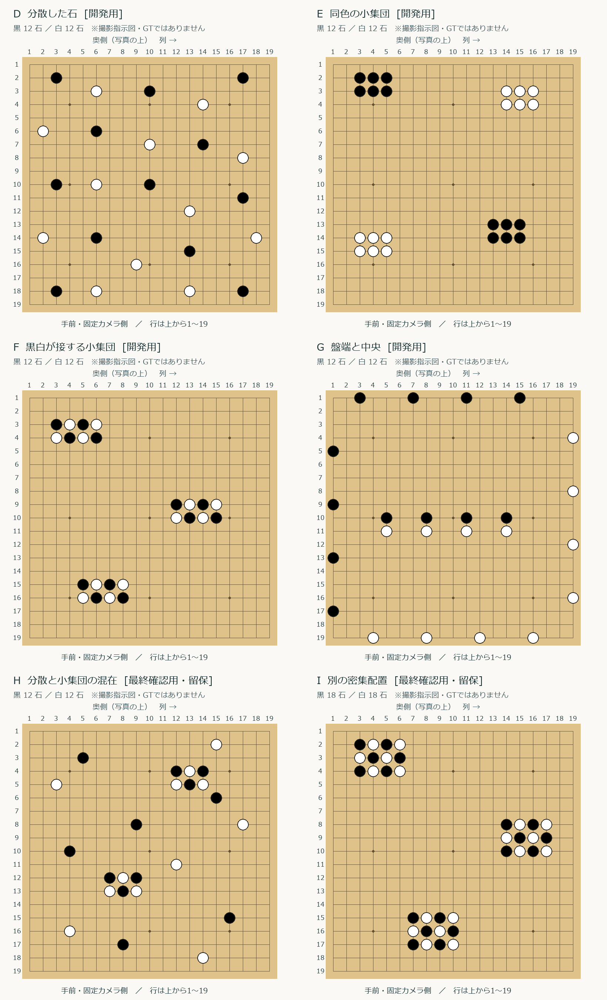
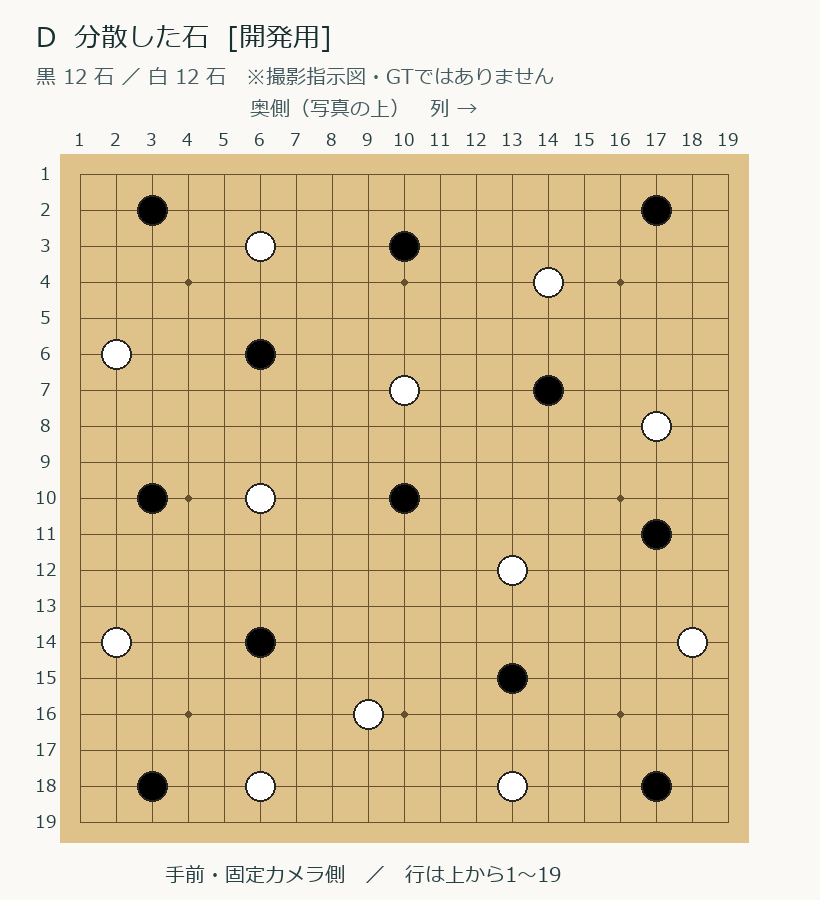
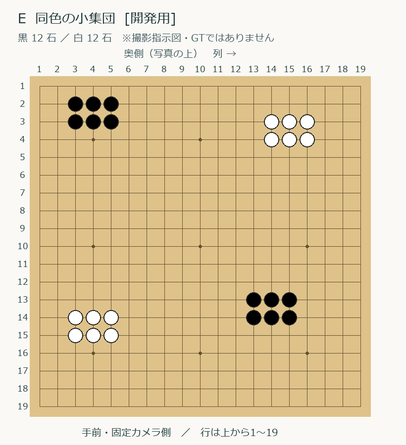
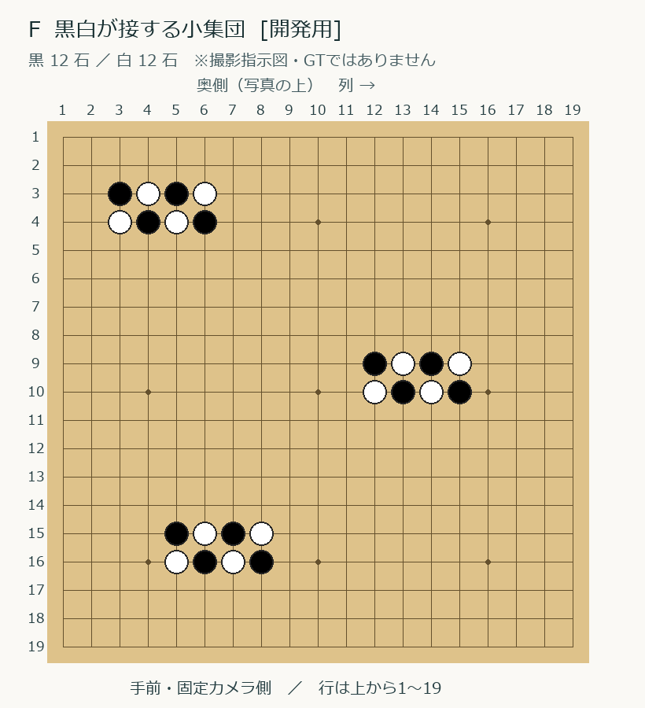
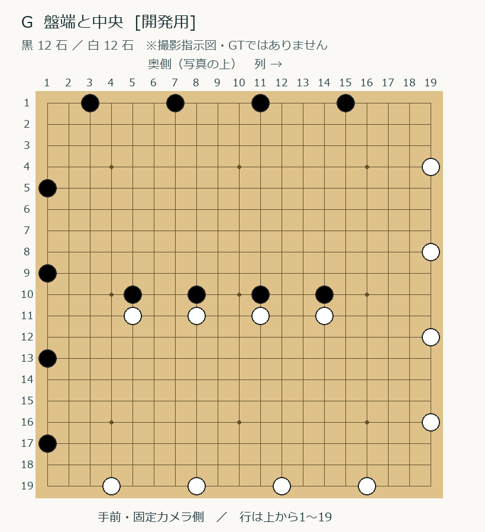
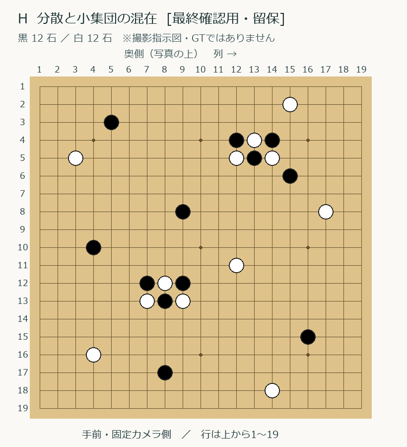
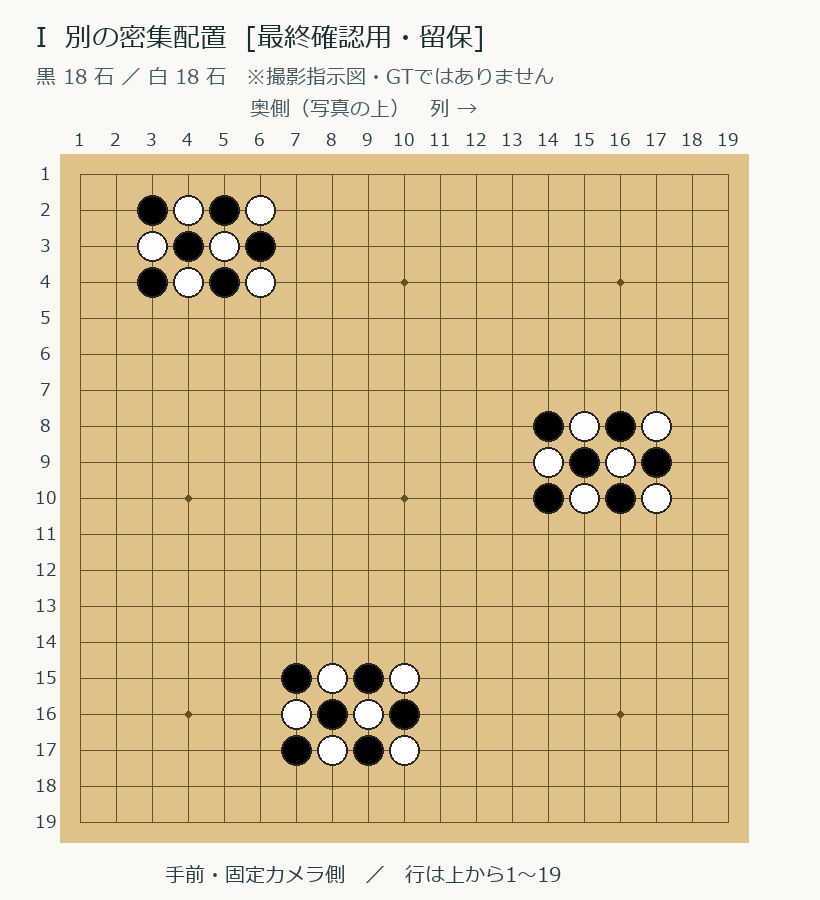

# 追加撮影D〜I：石を並べる指示図

2026-11-08、本人は追加GTを先に集める方針を選び、並べやすい6配置の指定を依頼した。D〜Gを開発用、H・Iを新たな最終確認用として留保する案で、まずDの1配置・2枚から進める。既存Cも留保のまま。これは撮影指示であり、実写真の確認済みGTではない。本人の確認前に図を正解GTと確定しない。本人の明示依頼により、位置合わせ確認後の未確認下書きとして利用できる（2026-11-08にDで適用）。

## 向きと撮影

- 19路盤の左上を1行1列。行は奥→手前、列は左→右。図の下が固定カメラ側。両写真とも同じ側が上になるようにする。
- 四隅の最外周交点は全図で空けている。Gは四隅以外の最外周に石を置く。
- 1配置を並べたら上方1枚、石を動かさず固定位置1枚。2枚の間で照明を変えない。写真は元JPEGで渡す。
- まず通常の照明で6配置を独立に撮る。反射の強弱などの対照撮影を後から足す場合、同じ配置なら同じ撮影グループに入れる。照明や角度だけを変えて別グループと数えない。
- 全12枚を一度に分類する必要はない。Dから1配置ずつ受領し、実写真の本人GTを作る。図を下書きへ使った場合も、実写真と違った点は実際の配置へ修正する。本人が全体を確認して分類完了するまで正解GTとしない。

## 6配置の一覧

| 配置 | 内容 | 黒／白 | 用途 |
| --- | --- | --- | --- |
| [D](assets/capture-layouts/D.png) | 分散した石 | 12／12 | 開発用 |
| [E](assets/capture-layouts/E.png) | 同色の小集団 | 12／12 | 開発用 |
| [F](assets/capture-layouts/F.png) | 黒白が接する小集団 | 12／12 | 開発用 |
| [G](assets/capture-layouts/G.png) | 盤端と中央 | 12／12 | 開発用 |
| [H](assets/capture-layouts/H.png) | 分散と小集団の混在 | 12／12 | 最終確認用・留保 |
| [I](assets/capture-layouts/I.png) | 別の密集配置 | 18／18 | 最終確認用・留保 |

## 座標表

以下は「行：列の一覧」。画像の数字と対応する。

### D：分散した石

- **黒**：2行：3・17列 ／ 3行：10列 ／ 6行：6列 ／ 7行：14列 ／ 10行：3・10列 ／ 11行：17列 ／ 14行：6列 ／ 15行：13列 ／ 18行：3・17列
- **白**：3行：6列 ／ 4行：14列 ／ 6行：2列 ／ 7行：10列 ／ 8行：17列 ／ 10行：6列 ／ 12行：13列 ／ 14行：2・18列 ／ 16行：9列 ／ 18行：6・13列

### E：同色の小集団

- **黒**：2行：3・4・5列 ／ 3行：3・4・5列 ／ 13行：13・14・15列 ／ 14行：13・14・15列
- **白**：3行：14・15・16列 ／ 4行：14・15・16列 ／ 14行：3・4・5列 ／ 15行：3・4・5列

### F：黒白が接する小集団

- **黒**：3行：3・5列 ／ 4行：4・6列 ／ 9行：12・14列 ／ 10行：13・15列 ／ 15行：5・7列 ／ 16行：6・8列
- **白**：3行：4・6列 ／ 4行：3・5列 ／ 9行：13・15列 ／ 10行：12・14列 ／ 15行：6・8列 ／ 16行：5・7列

### G：盤端と中央

- **黒**：1行：3・7・11・15列 ／ 5行：1列 ／ 9行：1列 ／ 10行：5・8・11・14列 ／ 13行：1列 ／ 17行：1列
- **白**：4行：19列 ／ 8行：19列 ／ 11行：5・8・11・14列 ／ 12行：19列 ／ 16行：19列 ／ 19行：4・8・12・16列

### H：分散と小集団の混在

- **黒**：3行：5列 ／ 4行：12・14列 ／ 5行：13列 ／ 6行：15列 ／ 8行：9列 ／ 10行：4列 ／ 12行：7・9列 ／ 13行：8列 ／ 15行：16列 ／ 17行：8列
- **白**：2行：15列 ／ 4行：13列 ／ 5行：3・12・14列 ／ 8行：17列 ／ 11行：12列 ／ 12行：8列 ／ 13行：7・9列 ／ 16行：4列 ／ 18行：14列

### I：別の密集配置

- **黒**：2行：3・5列 ／ 3行：4・6列 ／ 4行：3・5列 ／ 8行：14・16列 ／ 9行：15・17列 ／ 10行：14・16列 ／ 15行：7・9列 ／ 16行：8・10列 ／ 17行：7・9列
- **白**：2行：4・6列 ／ 3行：3・5列 ／ 4行：4・6列 ／ 8行：15・17列 ／ 9行：14・16列 ／ 10行：15・17列 ／ 15行：8・10列 ／ 16行：7・9列 ／ 17行：8・10列

## このバッチの目的と限界

追加6配置・12枚は、作業量を区切るための最初のバッチで、学習に十分な量を保証する基準ではない。全て完成すれば、既存分と合わせて開発用15枚・7配置、留保用6枚・3配置になる。独立した環境や盤・端末の多様性は別に増やす必要がある。H・Iは既存Cと同様、モデル選択・特徴量調整・失敗例分析へ使わない。

図の正本はassets/capture-layouts/layouts.json。再描画はpython scripts/labeling/render_capture_layouts.py（Pillow・メイリオが使えるWindows環境）。重複・座標範囲・四隅をコードで検査し、生成図を目視確認した。実験の進め方は [モデル比較計画](model-experiment-plan.md) を参照する。
